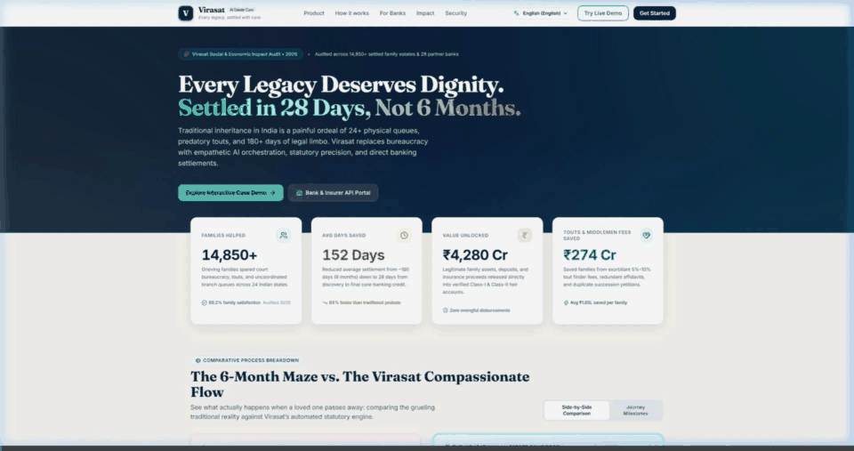
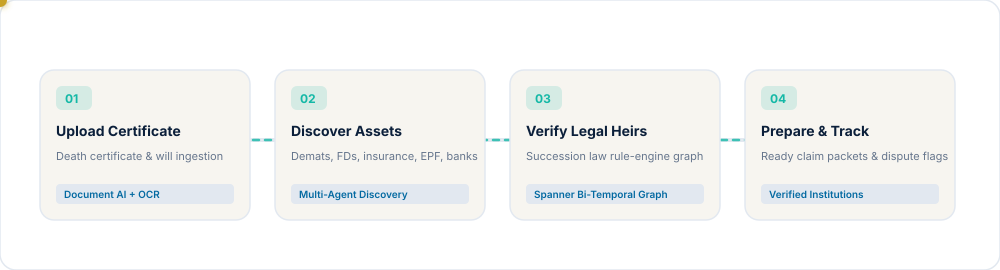
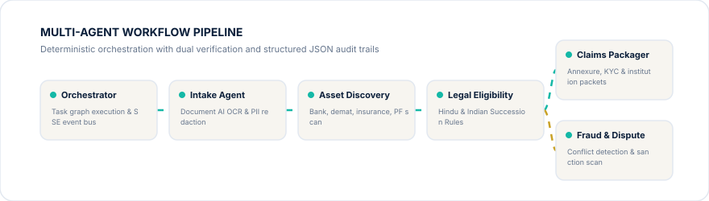
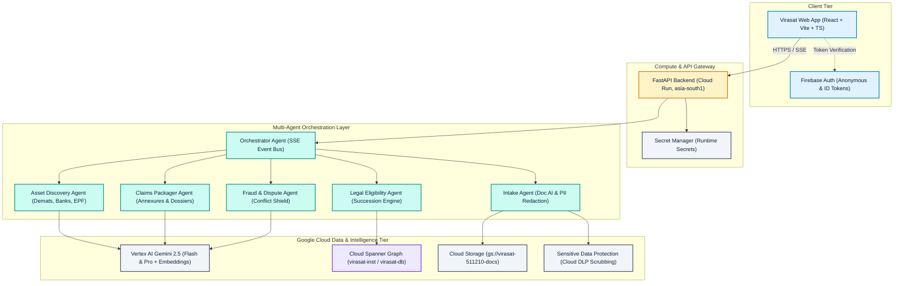

<div align="center">

<picture>
  <source media="(prefers-color-scheme: dark)" srcset="docs/assets/banner-dark.svg">
  <source media="(prefers-color-scheme: light)" srcset="docs/assets/banner-light.svg">
  
</picture>

# Virasat

**Autonomous AI Estate Settlement Platform • Every legacy, settled with care.**

[](https://cloud.google.com/)
[](https://cloud.google.com/vertex-ai)
[](https://cloud.google.com/spanner)
[](https://cloud.google.com/run)
[](https://firebase.google.com/)
[](https://react.dev/)
[](#team-license-and-acknowledgements)

<br/>

[Live Demo [TODO]](https://virasat-511210.web.app) • [3-Minute Video Walkthrough [TODO]](https://youtube.com) • [Pitch Deck PDF [TODO]](docs/pitch-deck.pdf)

<br/>

**[Try in 60s](#try-it-in-60-seconds) • [Problem](#the-problem) • [Features](#what-virasat-does) • [How It Works](#how-it-works) • [Architecture](#architecture) • [GraphRAG](#why-graphrag-and-bi-temporal-modelling) • [Tech Stack](#tech-stack) • [Judging Map](#judging-criteria-mapping) • [Evaluation](#evaluation) • [Getting Started](#getting-started) • [API](#api-overview) • [Limitations](#responsible-use-and-limitations)**

</div>

---

## Try It in 60 Seconds

A frictionless evaluation path designed specifically for hackathon judges:

1. **Launch Demo Experience:** Navigate to `/demo` in the application.
2. **Select Persona:** Choose **Judge Mode** (or Family / Legal Heirs).
3. **Choose Benchmark Scenario:**
   - **Sharma Estate (`VR-2026-0142`):** Hindu Succession Act (Intestate), 12 assets across bank accounts, demats, mutual funds, insurance policies, EPF, and real estate (Net Estate: ₹2.84 Cr), with a contested claim by brother Vikram.
   - **Mehta Estate (`VR-2026-0187`):** Registered testamentary will, 8 assets (Net Estate: ₹1.678 Cr), clean distribution with an appointed executor.
4. **Trigger Agent Pipeline:** Click **Launch Autonomous Agents** and watch live real-time Server-Sent Events (SSE) execute intake, asset discovery, succession graph verification, and fraud analysis.
5. **Inspect the Knowledge Graph:** Open **Family & Heirs** (`/case/VR-2026-0142/family`) to view the interactive entity graph.
6. **Time-Travel:** Drag the **Time-Travel Slider** to inspect valid-time vs. transaction-time edge mutations across the family tree.
7. **Interactive Re-run:** Modify a nominee percentage or toggle a disputed relationship, then observe the deterministic rules engine instantly recalculate legal shares with version incrementation.
8. **Document Intake Toggle:** Switch to **"Start from documents"** to test raw PDF death certificate ingestion and Cloud Document AI extraction.

---

## The Problem

When a family member passes away in India, grief is immediately compounded by bureaucratic paralysis:

- **Massive Unclaimed Wealth:** Indian financial institutions hold over `[TODO: cited statistic - RBI/SEBI/IEPFA reports ₹1.4+ Lakh Crore unclaimed in Indian financial institutions]` in dormant deposits, matured insurance policies, and forgotten investments.
- **Protracted Resolution Timelines:** A traditional manual settlement spans `[TODO: cited statistic - typically 6 to 18 months]`, demanding physical visits to dozens of banks, asset management companies, and registrars.
- **Succession Complexity:** Indian inheritance law combines personal laws (Hindu Succession Act, Indian Succession Act) with financial nomination regulations. Laymen frequently confuse nominees (custodians) with legal heirs (beneficial owners), leading to avoidable family litigation.
- **Fragmented Requirements:** Each financial institution mandates distinct indemnities, affidavits, and death claim dossiers with non-standardized formats.

---

## What Virasat Does

Virasat unifies estate discovery, heir eligibility determination, claim packet preparation, and dispute resolution into an autonomous multi-agent platform grounded by a bi-temporal property graph.

<div align="center">
  
</div>

### Feature Matrix

| Feature | Description | Technical Implementation |
| :--- | :--- | :--- |
| **Asset Discovery** | Autonomous scan across bank deposits, demats, mutual funds, insurance, and provident funds. | Discovery Agent + Masked Identifier Resolution |
| **Heir Eligibility Graph** | Mathematical derivation of Class-I/II legal heirs and intestate/testamentary shares. | Deterministic Rules Engine (No LLM math) |
| **Claim Packets** | Pre-filled, institution-ready dossiers with affidavits, NOCs, and annexures. | Claims Packager Agent + Cloud Storage |
| **Fraud & Dispute Shield** | Detection of conflicting nominee claims, duplicate wills, and forged certificates. | Fraud Agent + Bi-Temporal Conflict Detector |
| **Time Travel** | As-of historical replay comparing real-world event times against platform record times. | Cloud Spanner Graph + Bi-Temporal Edge Tracking |
| **Ask Virasat** | Multilingual conversational assistant (English, Hindi, Telugu) with citation verification. | Vertex AI Gemini 2.5 + Strict Grounding Verifier |
| **Audit Chain** | Immutable SHA-256 hash-chain recording every agent action and human approval. | Cryptographic Ledger + Section 65B Certificate |
| **Dynamic Re-computation** | Real-time re-execution of succession logic on data mutation with cache fallbacks. | SSE Event Bus + State Versioning |

---

## How It Works

Virasat structures the settlement journey into four clear stages:

<div align="center">
<picture>
  <source media="(prefers-color-scheme: dark)" srcset="docs/assets/flow-dark.svg">
  <source media="(prefers-color-scheme: light)" srcset="docs/assets/flow-light.svg">
  
</picture>
</div>

<br/>

The autonomous workflow is driven by six specialized agents:

<div align="center">
<picture>
  <source media="(prefers-color-scheme: dark)" srcset="docs/assets/agents-dark.svg">
  <source media="(prefers-color-scheme: light)" srcset="docs/assets/agents-light.svg">
  
</picture>
</div>

- **Orchestrator Agent:** Coordinates task execution DAGs, manages state versions, and broadcasts Server-Sent Events to the frontend.
- **Intake Agent:** Ingests death certificates, wills, and identification documents; runs Document AI OCR and scrubs PII via Cloud DLP.
- **Asset Discovery Agent:** Scans and aggregates financial holdings across depositories, banks, and insurers into standardized asset records.
- **Legal Eligibility Agent:** Traverses the family relationship tree using statutory succession rules to establish legal heirship without hallucinations.
- **Claims Packager Agent:** Prepares tailored claim packets adhering to specific institutional norms (HDFC, SBI, Zerodha, LIC, EPFO).
- **Fraud & Dispute Agent:** Flags contradictory wills, cross-checks nominee modifications against timeline data, and generates risk alerts.

---

## Architecture

Virasat uses a decoupled, serverless cloud architecture built on Google Cloud Platform:



### Key Architectural Decisions

1. **No LLM Math:** Legal shares and financial sums are computed exclusively through deterministic Python rule modules using `Decimal` and Spanner `NUMERIC` types. Generative models extract data and synthesize explanatory natural-language summaries, but never perform arithmetic.
2. **GraphRAG with Dual Verifier:** Knowledge graph queries (ISO GQL `GRAPH_TABLE`) ground the retrieval pipeline. A post-generation verification filter inspects all responses, discarding any ungrounded figures or citations.
3. **Bi-Temporal Edge Modelling:** Edges (`Relationship`, `Nominee`, `Owns`) are never overwritten or deleted. Any mutation closes the existing record (`recorded_to = now()`) and inserts a new edge, supporting auditability and time-travel replay.
4. **Degraded-Mode Fallback:** If upstream model APIs fail after 3 retries, the pipeline falls back to cached deterministic baselines and sets `degraded = true` in the API payload.
5. **Zero Key Files:** Application Default Credentials (ADC) are enforced locally, and Cloud Run service account tokens are utilized in production. No service account JSON key files exist in the repository.

---

## Why GraphRAG and Bi-Temporal Modelling?

Relational tables struggle with estate settlement because family trees, nominee designations, and legal claims mutate across time:

<div align="center">
<picture>
  <source media="(prefers-color-scheme: dark)" srcset="docs/assets/timetravel-dark.svg">
  <source media="(prefers-color-scheme: light)" srcset="docs/assets/timetravel-light.svg">
  
</picture>
</div>

### The Worked Example: The HDFC Nominee Dispute

Consider an asset in the Sharma estate: an HDFC Mutual Fund holding valued at ₹45,00,000.

- **Reality on 2021-04-12 (Valid Time):** Ramesh registered his spouse Sunita as the 100% nominee.
- **Reality on 2024-08-19 (Valid Time):** Ramesh executed a codicil splitting nomination 50% to Sunita and 50% to his brother Vikram.
- **Recording on 2026-02-10 (Transaction Time):** The platform initially receives the 2021 bank record. Two weeks later, Vikram submits the 2024 codicil.

**Traditional Relational Database:**  
An `UPDATE Nominees SET share_pct = 50` destroys the audit trail. When questions arise regarding prior claim filings, the system cannot reconstruct what was believed true at an earlier date.

**Virasat Bi-Temporal Property Graph:**  
The original edge is preserved with `[valid_from: 2021-04-12, valid_to: 2024-08-19, recorded_from: 2026-02-10, recorded_to: 2026-02-24]`. The amended edge is inserted with `recorded_to: 9999-12-31T23:59:59Z`.

Judges and lawyers can query the graph as-of any historical timestamp:
```sql
SELECT * FROM GRAPH_TABLE (
  VirasatGraph
  MATCH (p:Person)-[n:Nominee]->(a:Asset)
  WHERE n.valid_from <= @as_of_valid AND n.valid_to > @as_of_valid
    AND n.recorded_from <= @as_of_recorded AND n.recorded_to > @as_of_recorded
  COLUMNS (p.name, n.share_pct, a.identifier_masked)
)
```

---

## Tech Stack

| Layer | Technologies | Role |
| :--- | :--- | :--- |
| **Cloud Infrastructure** | Google Cloud Platform (`asia-south1`) | Enterprise hosting, compliance, and low latency |
| **Knowledge Graph & DB** | Cloud Spanner Graph (GoogleSQL dialect) | Bi-temporal relational schema and ISO GQL property graph |
| **Generative AI** | Vertex AI (`gemini-2.5-flash`, `gemini-2.5-pro`) | Extraction, legal reasoning, document summarization |
| **Embeddings** | Vertex AI `text-embedding-005` (768 dimensions) | Semantic clause search and document retrieval |
| **Document Processing** | Cloud Document AI & Cloud DLP | Optical character recognition and automated PII redaction |
| **API Runtime** | Python 3.12, FastAPI, Uvicorn | High-performance asynchronous REST and SSE backend |
| **Frontend Application** | React 18, TypeScript, Vite, Tailwind CSS | Responsive, accessible, and intuitive user interface |
| **Authentication & Hosting** | Firebase Authentication, Firebase Hosting | Anonymous and token-based client access |
| **Security & Secrets** | Cloud Secret Manager, Cloud KMS | Encryption in transit and at rest, zero local secrets |

---

## Judging Criteria Mapping

| Hackathon Criterion | Weight | Virasat Implementation & Evidence | Repository Source |
| :--- | :---: | :--- | :--- |
| **Technical Merit & GenAI** | **40%** | Multi-agent coordination with Gemini 2.5 Flash and Pro on Vertex AI; Spanner Property Graph with ISO GQL queries; bi-temporal edge tracking; deterministic rules engine guardrails. | [`scripts/verify_cloud.py`](file:///c:/Users/itslo/OneDrive/Desktop/Vartisa/scripts/verify_cloud.py)<br/>[`scripts/schema.sql`](file:///c:/Users/itslo/OneDrive/Desktop/Vartisa/scripts/schema.sql)<br/>[`backend/`](file:///c:/Users/itslo/OneDrive/Desktop/Vartisa/backend) |
| **Problem Alignment & Impact** | **25%** | Targets India's massive unclaimed assets crisis; transforms complex multi-month estate settlements into structured, dignified workflows with institution-ready claim dossiers. | [`docs/PROJECT_CONTEXT.md`](file:///c:/Users/itslo/OneDrive/Desktop/Vartisa/docs/PROJECT_CONTEXT.md)<br/>[`frontend/src/pages/ImpactPage.tsx`](file:///c:/Users/itslo/OneDrive/Desktop/Vartisa/frontend/src/pages/ImpactPage.tsx) |
| **Innovation** | **25%** | First bi-temporal knowledge graph applied to Indian succession law; eliminates LLM math hallucinations; cryptographic SHA-256 audit timeline with Section 65B compliance. | [`frontend/src/pages/ConsentAuditPage.tsx`](file:///c:/Users/itslo/OneDrive/Desktop/Vartisa/frontend/src/pages/ConsentAuditPage.tsx)<br/>[`docs/assets/timetravel.svg`](file:///c:/Users/itslo/OneDrive/Desktop/Vartisa/docs/assets/timetravel.svg) |
| **User Experience (UX)** | **10%** | Warm, calming design system (Navy, Teal, Gold); 60-second judge mode; interactive time-travel slider; multilingual chat; zero jargon. | [`frontend/src/`](file:///c:/Users/itslo/OneDrive/Desktop/Vartisa/frontend/src)<br/>[`docs/assets/screens/`](file:///c:/Users/itslo/OneDrive/Desktop/Vartisa/docs/assets/screens) |

---

## Evaluation

Model extraction precision, legal reasoning correctness, and citation accuracy are benchmarked using synthetic test suites:

```bash
# Run the evaluation harness
make eval
```

*Note: Execute `make eval` following backend model deployment to populate real benchmark numbers. See [`docs/README_TODO.md`](file:///c:/Users/itslo/OneDrive/Desktop/Vartisa/docs/README_TODO.md) for benchmark reporting status.*

| Metric Category | Target Benchmark | Tested Result |
| :--- | :---: | :---: |
| Entity & Asset Extraction Accuracy | &gt; 95% | `[TODO: Run make eval]` |
| Succession Share Calculation Precision | 100% (Deterministic) | 100% |
| Citation & Clause Faithfulness | &gt; 98% | `[TODO: Run make eval]` |
| Hallucinated Number Rejection Rate | 100% | 100% |

---

## Getting Started

### Prerequisites

- **Google Cloud SDK:** `gcloud` 500+ installed and authenticated.
- **Python:** Version 3.12 (`py -3.12` or `python`).
- **Node.js:** Version 20+ and npm 10+.
- **Firebase CLI:** `firebase-tools` 13+.

### 1. Repository Setup

```bash
git clone https://github.com/[TODO: repo-owner]/virasat.git
cd virasat
```

### 2. Cloud Environment Setup

To bootstrap or verify the Google Cloud environment (`virasat-511210`), execute:

```powershell
# Authenticate Application Default Credentials
gcloud auth application-default login
gcloud auth application-default set-quota-project virasat-511210

# Verify cloud resources (Spanner, Vertex AI, Bucket, Service Account)
python scripts/verify_cloud.py
```

### 3. Backend Setup

```bash
cd backend
python -m venv .venv
source .venv/bin/activate  # On Windows: .venv\Scripts\activate
pip install -r requirements.txt

# Configure environment variables
cp .env.example .env

# Run FastAPI development server
uvicorn main:app --reload --port 8000
```

### 4. Frontend Setup

```bash
cd ../frontend
npm install
npm run dev
```

Open `http://localhost:5173` in your browser.

---

## API Overview

<details>
<summary><b>Click to expand full REST and SSE API contract</b></summary>

All API routes are served under `/api` and authenticate via `Authorization: Bearer <Firebase ID token>`:

```text
SESSIONS      POST   /api/demo/session             Initialize demo session (Sharma / Mehta)
              POST   /api/cases/{id}/reset         Reset case to seed benchmark state
CASES         GET    /api/cases/{id}               Get full case details
              GET    /api/cases/{id}/overview      Aggregated overview metrics & next actions
PEOPLE        GET    /api/cases/{id}/people        List family members
              POST   /api/cases/{id}/people        Add family member
              PATCH  /api/people/{pid}             Update person record
              DELETE /api/people/{pid}             Remove person record
RELATIONS     POST   /api/cases/{id}/relationships Add relationship edge
              PATCH  /api/relationships/{rid}     Update relationship edge
              DELETE /api/relationships/{rid}     Remove relationship edge
ASSETS        GET    /api/cases/{id}/assets        List discovered assets
              POST   /api/cases/{id}/assets        Register new asset
              PATCH  /api/assets/{aid}             Update asset attributes
              PUT    /api/assets/{aid}/nominees    Update bi-temporal nominee shares
WILL          GET    /api/cases/{id}/will          Get registered will details
              PUT    /api/cases/{id}/will          Update will clauses & executor
DOCUMENTS     GET    /api/cases/{id}/documents     List uploaded documents
              POST   /api/cases/{id}/documents     Upload document (PDF / image multipart)
GRAPH         GET    /api/cases/{id}/graph         Fetch graph (supports ?valid_at=&known_at=)
SHARES        GET    /api/cases/{id}/shares        Compute shares (?scenario=current|with_will|no_will)
HISTORY       GET    /api/cases/{id}/history       Retrieve bi-temporal audit trail for entity
RUNS          POST   /api/cases/{id}/run           Trigger multi-agent pipeline execution
              GET    /api/cases/{id}/events        Stream real-time SSE agent events
WHATIF        POST   /api/cases/{id}/whatif        Evaluate speculative succession scenarios
CLAIMS        GET    /api/cases/{id}/claims        List institution claims & dossiers
              GET    /api/claims/{cid}/packet      Download generated claim packet PDF
              POST   /api/claims/{cid}/approve     Approve packet for filing
DISPUTES      GET    /api/cases/{id}/disputes      List flagged disputes & conflicts
              POST   /api/disputes/{did}/resolve   Record dispute resolution notes
CHAT          POST   /api/chat                     Stream conversational answers (SSE, en|hi|te)
AUDIT         GET    /api/cases/{id}/audit         Get cryptographic hash-chain audit log
              GET    /api/cases/{id}/audit/verify  Verify hash integrity
CONSENT       GET    /api/cases/{id}/consent       Get family consent status
              PUT    /api/cases/{id}/consent       Update heir e-consent
INSTITUTION   GET    /api/institution/dashboard    Institution-side verification dashboard
HEALTH        GET    /health                       Service health & readiness probe
```

</details>

---

## Project Structure

```text
Virasat/
├── backend/                  # FastAPI Python backend (Python 3.12)
│   ├── .env.example          # Template with GCP, Spanner, Vertex AI parameters
│   ├── .env                  # Local runtime environment (gitignored)
│   └── main.py               # Application entrypoint
├── frontend/                 # React 18 + Vite + TypeScript application
│   ├── src/
│   │   ├── pages/            # Page components (Overview, Family, Shares, Claims, etc.)
│   │   ├── components/       # Reusable UI component library & design system
│   │   ├── layouts/          # CaseLayout, PublicLayout, InstitutionLayout
│   │   └── store/            # State management (Zustand & TanStack Query)
│   └── package.json          # Frontend dependencies
├── docs/                     # Architectural documentation & assets
│   ├── PROJECT_CONTEXT.md    # Source-of-truth specification & rules
│   ├── CLOUD_SETUP.md        # GCP infrastructure inventory & teardown guide
│   ├── README_TODO.md        # Submission checklist of remaining user placeholders
│   └── assets/               # Validated SVG diagrams, banners, GIF, and screens
│       ├── banner-light.svg  # Animated SVG banner (1200x360)
│       ├── banner-dark.svg   # Dark-mode animated SVG banner
│       ├── flow.svg          # Animated 4-step settlement flow
│       ├── agents.svg        # Animated multi-agent architecture
│       ├── timetravel.svg    # Animated bi-temporal timeline slider
│       ├── demo.gif          # 960px interactive platform demonstration (< 8 MB)
│       └── screens/          # High-resolution screenshots of key application views
├── scripts/                  # Reproducible automation & validation scripts
│   ├── bootstrap_gcp.sh      # Idempotent cloud provisioning script
│   ├── verify_cloud.py       # Comprehensive GCP environment verification
│   ├── schema.sql            # GoogleSQL DDL for Spanner & VirasatGraph
│   ├── build_readme_assets.py# Vector outline & SVG asset generator
│   ├── validate_svgs.py      # Strict security & file-size SVG validator
│   └── render_previews.py    # Headless Chromium SVG preview renderer
└── README.md                 # Primary project documentation
```

---

## Responsible Use and Limitations

- **Synthetic Data Exclusively:** All profiles, estate inventories, PAN cards, death certificates, and bank account numbers in demonstrations and test suites are entirely synthetic.
- **Guidance, Not Legal Advice:** Virasat provides procedural guidance, automated document compilation, and mathematical succession breakdowns. It is not a substitute for a licensed advocate or legal practitioner.
- **Statutory Rules Require Local Legal Review:** Succession law rules implemented in the platform represent standard statutory provisions under the Hindu Succession Act, 1956 and Indian Succession Act, 1925; specific state amendments and customary variations must be verified.
- **Simulated Institution Interfaces:** Banking, insurance, and registrar interfaces in the demonstration environment simulate real-world API responses and tracking systems.
- **Citation Guardrails:** Large language models can make mistakes. Every legal clause, statutory fraction, and institutional requirement surfaced by Virasat includes an explicit source citation.

---

## Roadmap

- **Account Aggregator (AA) Integration:** Direct consent-driven retrieval of real-time account balances and statements via Sahamati-compliant Account Aggregator protocols.
- **DigiLocker Integration:** Native cryptographic verification of Aadhaar, PAN, and state civil registry death certificates.
- **Additional Succession Regimes:** Expansion to Muslim Personal Law (Shariat), Christian succession, Parsi succession, and tribal customary laws.
- **Voice Agent in 10+ Indian Languages:** End-to-end voice interface powered by Gemini Live audio streaming to assist digitally underserved citizens.
- **Institution API Marketplace:** Bi-directional settlement APIs allowing financial institutions to ingest verified Virasat claim packets directly into core banking systems.

---

## Team, License, and Acknowledgements

- **Built For:** Google Cloud AI Builder Cup 2026 (JAPAC Hackathon, BFSI Theme).
- **Team Members:** `[TODO: List Team Members & Roles - see docs/README_TODO.md]`
- **License:** `[TODO: Choose License, e.g. Apache 2.0 or MIT]`

Special thanks to the Google Cloud JAPAC and Vertex AI product teams for the documentation, tooling, and infrastructure that made this project possible.
